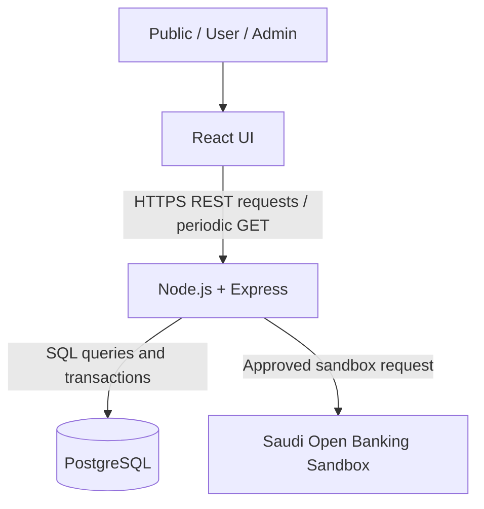
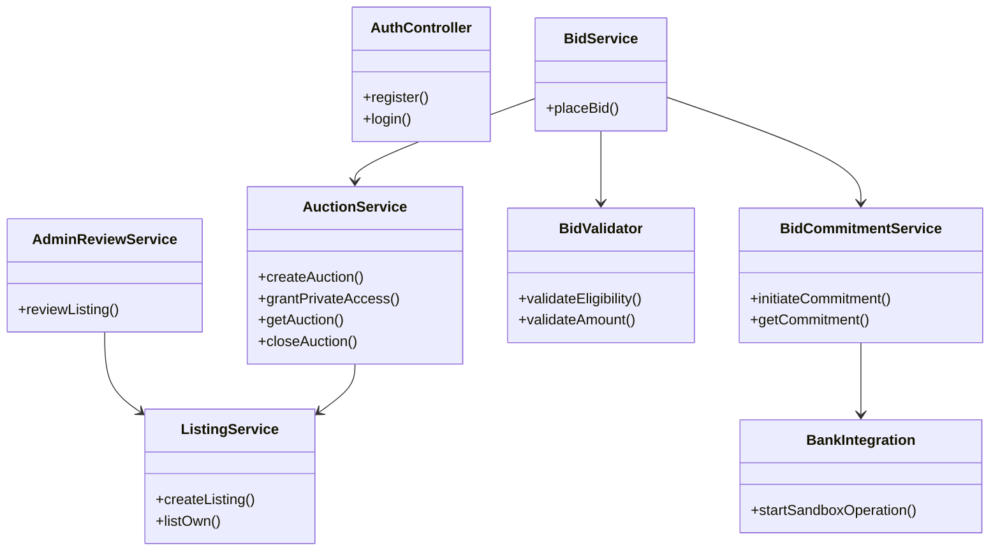
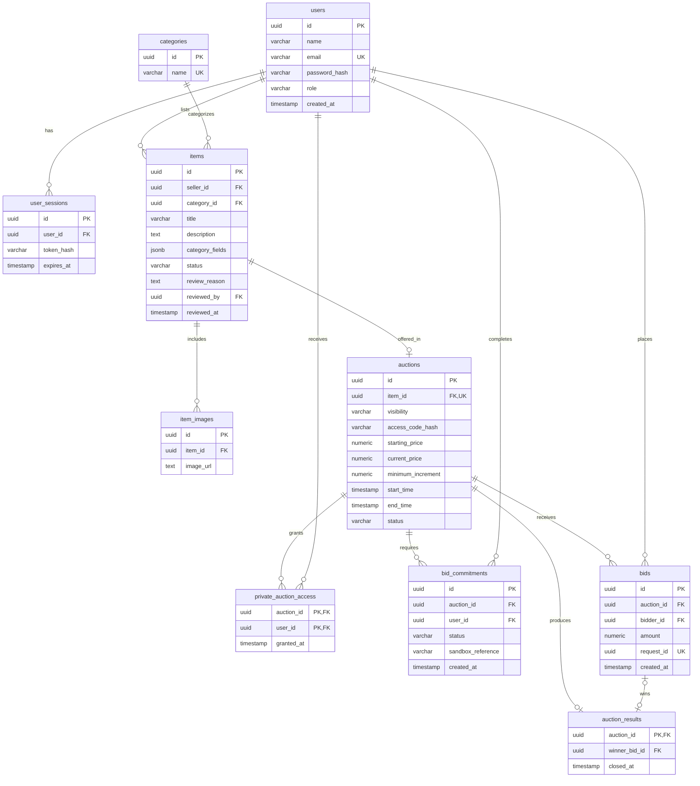
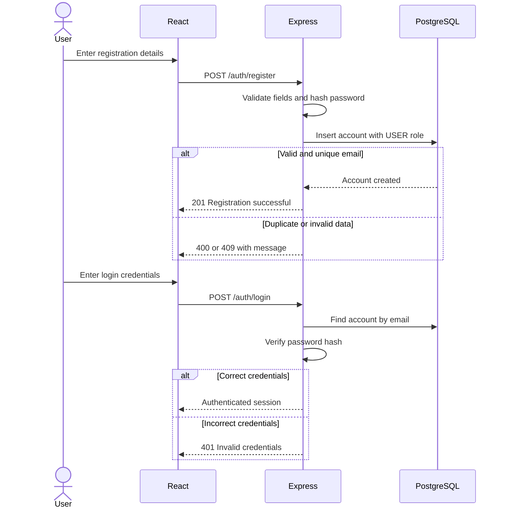
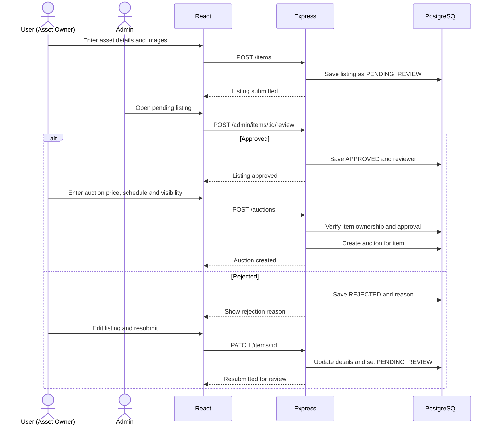
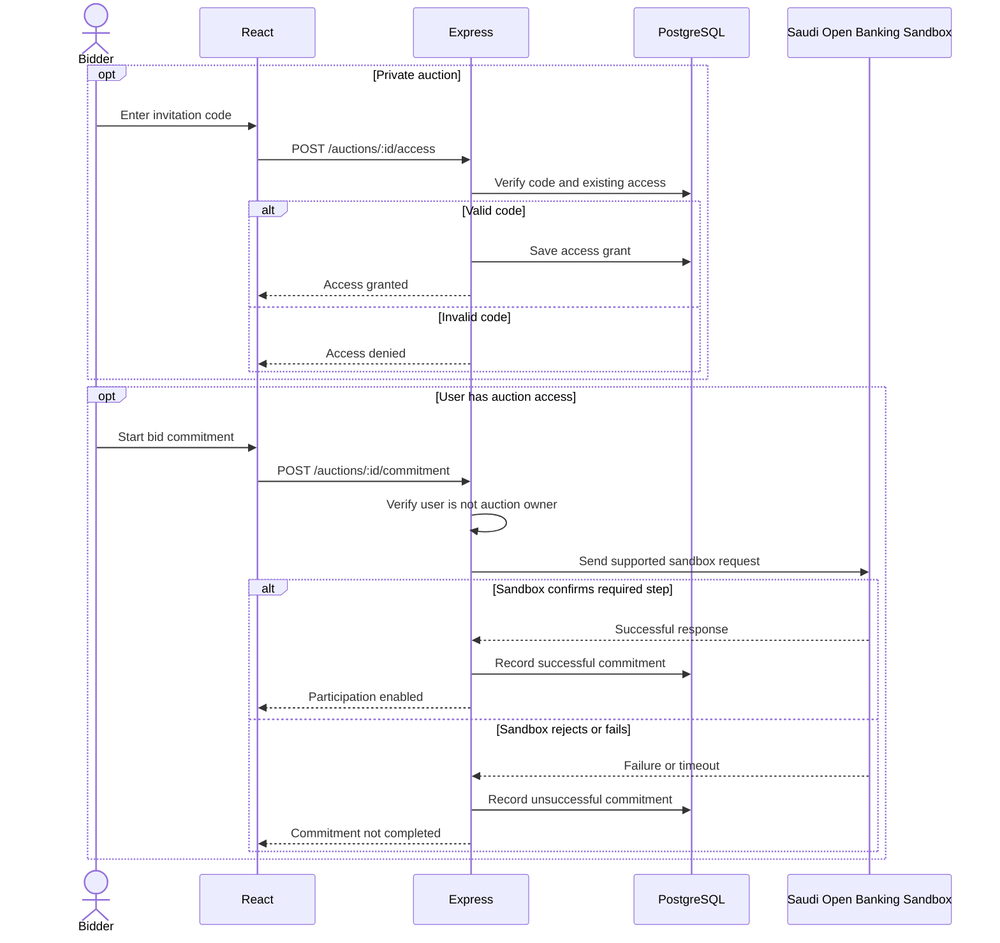
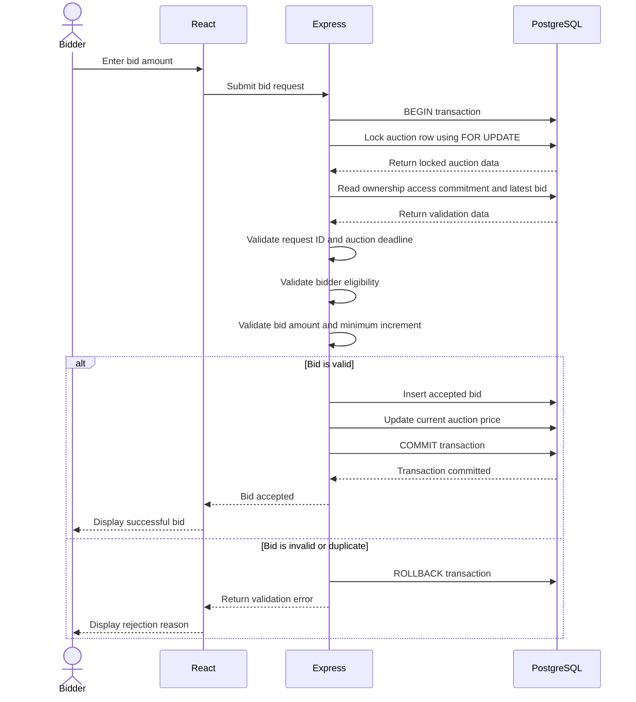

# Mezyad — Stage 3 Technical Documentation

---

## 1. Preface

Mezyad is a web-based auction platform for high-value assets. It provides a clear process for sellers to list assets, for administrators to review submitted listings, and for bidders to participate in public or private auctions.

A seller creates a listing with the asset details and images. After administrator approval, the seller can create an auction by setting its starting price, minimum bid increment, start time, end time, and visibility. Public auctions can be discovered through the platform. Private auctions are shared by their sellers and require an access code before a bidder can participate.

Bidders can browse auction details, complete the bid commitment step, submit bids, follow the current price and bidding history, and view the auction result. The system validates each bid on the server to prevent invalid prices, bids after the deadline, and unauthorized participation. A Saudi Open Banking sandbox integration supports the project's banking-related participation flow without transferring real money.

Mezyad uses **React** for the user interface, **Node.js and Express** for backend requests, and **PostgreSQL** for data storage. The auction page requests updated information from the server at regular intervals. PostgreSQL transactions keep bid records and auction prices consistent when multiple users submit bids close together.

The platform also includes small usability features such as clear form errors, bid confirmation, auction status labels, and a description suggestion button that formats seller-provided asset information into an editable paragraph.

The project focuses on a complete and understandable auction workflow, from listing submission to the final auction result.

---

## 2. User Stories & Mockups

### 2.1 Prioritized User Stories (MoSCoW)

| Priority | Role | User Story |
|---|---|---|
| **Must Have** | User (Seller / Bidder) | As a new user, I want to register with my name, email and password so that I can create listings and participate in auctions using one account. |
| **Must Have** | User / Admin | As an account holder, I want to sign in and log out securely so that I can access my account and protect my session. |
| **Must Have** | User (Seller / Bidder) | As a user, I want to browse public auctions by category so that I can find assets that interest me. |
| **Must Have** | User (Seller / Bidder) | As a user, I want to open an auction and view its images, description, current price and schedule so that I can understand the asset before bidding. |
| **Must Have** | User (Seller) | As a seller, I want to create a listing with a title, category, description and asset-specific details so that I can present my asset clearly. |
| **Must Have** | User (Seller) | As a seller, I want to attach images to my listing so that other users can see the asset before participating. |
| **Must Have** | User (Seller) | As a seller, I want to submit my listing for review and see its approval status so that I know when I can create an auction. |
| **Must Have** | Admin | As an admin, I want to see submitted listings awaiting review so that I can examine them before they become available for auction. |
| **Must Have** | Admin | As an admin, I want to approve a suitable listing or reject it with a reason so that the seller receives a clear review decision. |
| **Must Have** | User (Seller) | As a seller, I want to create an auction from an approved listing so that I can offer my asset for bidding. |
| **Must Have** | User (Seller) | As a seller, I want to set the starting price, minimum bid increment and auction dates so that the auction follows the conditions I choose. |
| **Must Have** | User (Seller) | As a seller, I want to choose between a public and a private auction so that I can control how participants access my listing. |
| **Must Have** | User (Seller) | As a seller, I want to copy the access code for my private auction so that I can share it with invited participants. |
| **Must Have** | User (Bidder) | As a bidder, I want to enter a private auction access code so that I can view and join an auction I have been invited to. |
| **Must Have** | User (Bidder) | As a bidder, I want to complete the Bid Commitment process using the Saudi Open Banking sandbox so that I can meet the participation requirement. |
| **Must Have** | User (Bidder) | As a bidder, I want to know whether my commitment was completed successfully so that I can understand whether I am eligible to bid. |
| **Must Have** | User (Bidder) | As a bidder, I want to see the current price and minimum next bid so that I can enter a valid amount. |
| **Must Have** | User (Bidder) | As a bidder, I want to confirm my bid amount before submitting it so that I can avoid placing an incorrect bid. |
| **Must Have** | User (Bidder) | As a bidder, I want to place a bid on another user's auction and receive an acceptance or rejection message so that I know the outcome of my action. |
| **Must Have** | User (Bidder) | As a bidder, I want to see the latest accepted bids and remaining auction time so that I can follow the auction as it progresses. |
| **Must Have** | User (Seller / Bidder) | As an auction participant, I want to see whether an auction is scheduled, active or closed so that I understand its current status. |
| **Must Have** | User (Seller / Bidder) | As an auction participant, I want to see the final result when an auction closes so that I know whether a winning bid was recorded. |
| **Should Have** | User (Seller) | As a seller, I want to see the listings and auctions I created in My Activity so that I can follow their review status and results. |
| **Should Have** | User (Bidder) | As a bidder, I want to see auctions I have participated in under My Activity so that I can return to them easily. |
| **Should Have** | User (Seller / Bidder) | As a user, I want clear messages when a form is incomplete, an access code is invalid or a bid is rejected so that I know what to correct. |
| **Should Have** | Admin | As an admin, I want to view auction statuses and results so that I can monitor auction activity on the platform. |
| **Could Have** | User (Seller) | As a seller, I want a suggested listing description based on the asset information I entered so that I can prepare a clear description more quickly. |

### 2.2 Account Types

| Account | Description |
|---|---|
| **User (Seller / Bidder)** | A registered member with one account for both activities. **Seller** describes a user when creating a listing or managing an auction they own. **Bidder** describes the same type of user when joining and bidding in another member's auction. A user may act as both seller and bidder without creating separate accounts. |
| **Admin** | A platform administrator who reviews submitted listings, records approval or rejection decisions, and monitors auction activity. Admin accounts are not created through public registration. |

Public auctions can be browsed without signing in. A user signs in to submit listings, create auctions, access private auctions or place bids. The backend prevents a user from bidding on an auction they own.

### 2.3 UI Mockups & Design Approach

Mezyad uses React and an Arabic right-to-left interface with a vintage-inspired visual style, consistent typography, readable auction cards and clear navigation. The main screens are Home, Register/Login, Create Listing, Admin Review, Create Auction, Private Access, Commitment, Auction Details, Auction Result and My Activity.

**Account access:** A new member registers with a name, email and password. The system creates a standard USER account. The same login screen is used by users and administrators; the available functions depend on the authenticated role.

**Listing and review:** A signed-in user submits asset details and images. The listing appears under My Activity as Pending Review. An administrator examines the listing and records approval or rejection. Approved listings become available for auction creation.

**Auction creation:** The asset owner selects an approved listing, sets the starting price, minimum bid increment, start and end times, and chooses Public or Private. Public auctions appear in the general auction list. Private auctions use an invitation code that the owner can copy and share.

**Private auction participation:** A signed-in user enters the access code. The backend verifies the code and records the access grant before showing protected auction details.

**Commitment and bidding:** The user completes the required banking sandbox step, then enters a bid amount on an eligible auction owned by someone else. A confirmation dialog displays the amount. The backend validates the user, auction deadline, commitment, access and bid increment before accepting it.

**Results and activity:** Auction pages show current price, bid history and remaining time. When an auction ends, the final result shows the winning bid or a no-bids outcome. My Activity combines My Listings, My Auctions and My Bids for the same account.

**Interface feedback:** Loading indicators, validation messages, auction status labels, empty states and success/error notifications provide clear feedback throughout these screens.

### 2.4 Listing Description Suggestion

The Create Listing form includes a Suggest Description button. It combines information entered by the asset owner into a readable paragraph that can be edited before submission. For vehicles, the suggestion can use make, model, year, mileage and condition. The feature uses a simple React template and does not require a separate service or external AI model.

---

## 3. System Architecture



**One backend:** Express handles authentication, role checks, listings, admin review, auctions, bidding, and the sandbox integration. PostgreSQL is the authoritative source for bid prices, eligibility, access and closure state. The React countdown is informational; server time determines acceptance.

**Concurrency:** Lock the auction row using `SELECT ... FOR UPDATE` inside a PostgreSQL transaction; check the auction deadline and latest accepted price under that lock, then insert bid and update current price atomically. Do not use Redis or distributed locks.

**Updates:** React polls active auction details via GET every few seconds. Polling is not true push-based real-time. No Socket.io until a mentor requirement makes it necessary.

Asset image references are stored in `item_images`. The listing form sends image files to the backend upload handler.

### 3.1 Development environment

Local development can use React dev server, Express server and PostgreSQL. Use environment variables for DB connection and sandbox credentials. Do not commit secrets. Docker/Compose is optional pending official course requirements and team familiarity.

---

## 4. Backend Components & Class Design

### 4.1 Responsibilities

| Component | Responsibility | Main methods (illustrative) |
|---|---|---|
| AuthController | Register/login and session validation | register, login, authenticate |
| ListingService | Seller listing and images | createListing, listOwn, getListing |
| AdminReviewService | Approve/reject submitted listings | reviewListing |
| AuctionService | Create, access, view and close auctions | createAuction, grantPrivateAccess, getAuction, closeAuction |
| BidValidator | Validate bid rules | validateEligibility, validateAmount |
| BidService | Transactional bid acceptance | placeBid |
| BidCommitmentService | Record participation outcome | initiateCommitment, getCommitment |
| BankIntegration | Isolated sandbox calls | startSandboxOperation, handleSandboxResponse |

These components organize the Express routes and service functions. The description suggestion is handled directly in the React listing form.

### 4.2 Simplified class/component diagram



BidService handles database transactions for bid acceptance, while BidValidator contains eligibility and amount checks.

---

## 5. Database Design

PostgreSQL stores user accounts, asset listings, auctions, private access permissions, bid commitments, bids and auction results. Each auction belongs to one approved asset, and each accepted bid is linked to the user who submitted it. The database also records the relationship between an auction and its final result.

### 5.1 Entity Relationship Diagram

The ER diagram is divided into three connected areas: accounts and listings, auction access and participation, and bids and results. The `users` table represents both account types through the `role` field (`USER` or `ADMIN`). A standard user can be an asset owner in one auction and a bidder in another.



### 5.2 Database Tables

| Table | Main Fields | Purpose |
|---|---|---|
| `users` | `id`, `name`, `email`, `password_hash`, `role` | Stores User and Admin accounts. The same User account can sell and bid. |
| `user_sessions` | `id`, `user_id`, `token_hash`, `expires_at` | Tracks authenticated sessions. |
| `categories` | `id`, `name` | Defines the categories available when creating an asset listing. |
| `items` | `id`, `seller_id`, `category_id`, `title`, `description`, `category_fields`, `status`, `review_reason`, `reviewed_by`, `reviewed_at` | Stores asset information, its owner and the administrator's review decision. |
| `item_images` | `id`, `item_id`, `image_url` | Stores references to uploaded asset images. |
| `auctions` | `id`, `item_id`, `visibility`, `access_code_hash`, `starting_price`, `current_price`, `minimum_increment`, `start_time`, `end_time`, `status` | Stores auction settings, current price and timing. |
| `private_auction_access` | `auction_id`, `user_id`, `granted_at` | Records which users have been granted access to a private auction. |
| `bid_commitments` | `id`, `auction_id`, `user_id`, `status`, `sandbox_reference`, `created_at` | Stores each user's commitment status for an auction. |
| `bids` | `id`, `auction_id`, `bidder_id`, `amount`, `request_id`, `created_at` | Records accepted bids and prevents duplicate bid requests. |
| `auction_results` | `auction_id`, `winner_bid_id`, `closed_at` | Stores the final result; `winner_bid_id` is empty when no bids were accepted. |

### 5.3 Relationships and Data Integrity

**Account ownership.** `items.seller_id` identifies the user who submitted the asset. The auction owner is identified through `auctions.item_id` and `items.seller_id`, while `bids.bidder_id` identifies the user who submitted each bid. The backend verifies that a bidder is not the owner of the auction.

**Listing approval.** A listing starts with `PENDING_REVIEW`. An admin can change it to `APPROVED` or `REJECTED`. The owner may edit a rejected listing and resubmit it as `PENDING_REVIEW`; an approved listing is locked against material changes once its auction is created. Only an approved listing can be used to create an auction.

**Auction settings.** `current_price` starts at `starting_price` and represents the displayed price before the first accepted bid. The first bid must be at least `starting_price`; later bids must be at least the previous accepted amount plus `minimum_increment`. Each asset can be linked to one auction. The starting price and minimum increment must be positive, and the end time must be later than the start time. The visibility value is `PUBLIC` or `PRIVATE`. Private auction codes are stored as hashes.

**Private access.** The pair `(auction_id, user_id)` is unique in `private_auction_access`. Private auction details and bidding endpoints verify the user's access before returning protected data.

**Bid commitment.** A user has one commitment record per auction. Add a database `UNIQUE (auction_id, user_id)` constraint to enforce this rule. Its status is checked before a bid is accepted.

**Bid consistency.** Bid acceptance checks that the current user is not the owner through the asset relationship. The `request_id` value is unique for each submitted bid request. When accepting a bid, Express starts a PostgreSQL transaction and locks the auction row using `SELECT ... FOR UPDATE`. It then checks the current price, deadline, access, commitment and ownership before saving the bid and updating the auction price together.

**Auction closure.** The closing transaction verifies that `winner_bid_id`, when present, belongs to the same auction; the application should enforce this and the database can enforce it with a composite reference to `bids(auction_id, id)`. An auction stops accepting bids at its end time. The highest accepted bid determines the winning result. If no bids were accepted, `winner_bid_id` remains empty. A unique result per auction prevents duplicate closure records.

---
## 6. Sequence Diagrams

### Flow 1 — Registration and Login



### Flow 2 — Listing, Review and Auction Creation



### Flow 3 — Private Auction Access and Bid Commitment



### Flow 4 — Place Bid (Atomic PostgreSQL Transaction)



### Flow 5 — Auction Closure and Result

```mermaid
sequenceDiagram
  actor User
  participant UI as React
  participant API as Express
  participant DB as PostgreSQL
  User->>UI: Open auction after end time
  UI->>API: GET /auctions/:id
  API->>DB: BEGIN; lock auction row FOR UPDATE
  alt Result already recorded
    API->>DB: Read existing result
  else Auction has ended
    API->>DB: Read highest accepted bid for this auction
    alt Accepted bid exists
      API->>DB: Save winner bid ID and CLOSED status
    else No accepted bids
      API->>DB: Save result without winner and CLOSED status
    end
  end
  API->>DB: COMMIT
  API-->>UI: Closed auction and final result
```

The backend rejects bids based on server time even before the closure record is written. The same auction-row lock is used for bid acceptance and closure. The result is saved once and returned consistently on later requests.

---

## 7. API Specifications

### 7.1 Conventions

- Base prefix: `/api/v1`. Requests/responses use JSON except listing creation and editing with images, which use `multipart/form-data`.
- Authentication: secure session or verified token, consistently implemented.
- All sensitive routes require server-side role and ownership checks.
- Responses use consistent `{ "data": ... }` or `{ "error": { "code": "...", "message": "..." } }`.
- Typical status codes: 200 OK, 201 Created, 400 Bad Request, 401 Unauthorized, 403 Forbidden, 404 Not Found, 409 Conflict.
- For private auctions, avoid leaking existence or private details to unauthorized clients.

### 7.2 Endpoint contracts

| Method | Path | Role | Key request | Success response | Key failures |
|---|---|---|---|---|---|
| POST | /auth/register | Public | name,email,password | 201 user summary | 400,409 |
| POST | /auth/login | Public | email,password | 200 session/account | 401 |
| POST | /auth/logout | Signed in | — | 200 signed out | 401 |
| POST | /items | User | multipart form: category,title,description,category_fields,images | 201 listing | 400,403 |
| GET | /items | User/Admin | own listings or admin pending filter | 200 list | 401,403 |
| GET | /items/:id | Owner/Admin | item ID | 200 listing | 403,404 |
| PATCH | /items/:id | Owner | corrected fields/images for rejected listing | 200 PENDING_REVIEW | 400,403,409 |
| POST | /admin/items/:id/review | Admin | decision,reason? | 200 updated status | 403,409 |
| POST | /auctions | User (owner) | itemId,visibility,prices,times | 201 auction; private code to owner | 400,403,409 |
| GET | /auctions | Public | public filters/status | 200 public list | 400 |
| GET | /auctions/:id | Authorized | auction ID | 200 details/result | 403/404 |
| POST | /auctions/:id/access | User | accessCode | 200 access granted | 403/404,429 |
| POST | /auctions/:id/commitment | User | provider-specific validated fields | 200/201 commitment status | 400,403,502 |
| GET | /auctions/:id/commitment | User | — | 200 own status | 403,404 |
| POST | /auctions/:id/bids | User (not owner) | amount,requestId | 201 accepted bid | 400,403,409 |
| GET | /auctions/:id/bids | Authorized | paging params | 200 accepted bid history | 403/404 |
| GET | /me/auctions | User | — | 200 auctions owned or participated in | 401 |
| GET | /me/items | User | — | 200 own listings and review statuses | 401 |

Listing images are accepted with the listing request, validated for file type and size, stored by the backend, and referenced by `item_images.image_url`. The My Activity screen combines `/me/items` and `/me/auctions`. Auction closure is finalized when an ended auction is requested; the server rejects late bids independently of whether closure has been finalized. The endpoints are grouped by user-facing functionality and share one Express backend. The Description Builder is client-side and needs **no endpoint**.

### 7.3 Sample requests and responses

**Create auction:**
```json
{
  "itemId": "item-uuid",
  "visibility": "PRIVATE",
  "startingPrice": 50000,
  "minimumIncrement": 500,
  "startTime": "2026-11-01T10:00:00Z",
  "endTime": "2026-11-02T10:00:00Z"
}
```

**Successful private-auction creation:** `201`
```json
{
  "data": {
    "id": "auction-uuid",
    "status": "SCHEDULED",
    "visibility": "PRIVATE",
    "accessCode": "one-time-code-shown-to-owner"
  }
}
```

**Place bid:**
```json
{ "amount": 51000, "requestId": "unique-client-request-id" }
```

**Accepted:** `201`
```json
{ "data": { "bidId": "bid-uuid", "amount": 51000, "currentPrice": 51000 } }
```

**Rejected:** `409`
```json
{ "error": { "code": "BID_TOO_LOW", "message": "The amount must exceed the current bid by the minimum increment." } }
```

**Private access:** `POST /auctions/:id/access`
```json
{ "accessCode": "code-from-seller" }
```

**Admin review:** `POST /admin/items/:id/review`
```json
{ "decision": "REJECTED", "reason": "Please add a clear asset photo." }
```

### 7.4 Saudi Open Banking Sandbox Integration

| Item | Status |
|---|---|
| Provider and official documentation | To be specified in the integration contract |
| Available sandbox operation | To be specified in the integration contract |
| Test credentials / access | To be specified in the integration contract |
| Consent or authorization flow | To be specified in the integration contract |
| Callback or redirect requirements | To be specified in the integration contract |
| Exact commitment-to-bid rule | Defined by the approved integration requirements |
| Success/error sample payloads | To be specified in the integration contract |

**Implementation rule:** Do not invent a `proofOfFunds`, `holdFunds`, `transfer`, or `sendSMS` endpoint. Once the real sandbox operation is selected, replace the abstract sequence and add precise request/response examples.

---

## 8. SCM and QA Plans

### 8.1 Four-week execution plan (remaining implementation window)

| Week | Deliverables | Acceptance checkpoint |
|---|---|---|
| 1 | Project setup; database schema; auth; initial listing form; sandbox access proof | Team can sign in, save listing, and demonstrate a genuine sandbox test call |
| 2 | Admin review; auction creation; public/private access; basic screens | Seller-to-admin-to-private-auction journey works |
| 3 | Commitment integration; transactional bidding; closure; results | Concurrent bid and end-time tests pass |
| 4 | End-to-end testing; UX polish; bug fixes; mentor demo rehearsal | Full public and private flows work without manual database edits |

This four-week schedule organizes the implementation tasks while the team follows the course milestones.

### 8.2 Source control

- `main`: reviewed stable code.
- `feature/*`: short-lived feature branches.
- Pull request before merge; at least one teammate reviews changes.
- Small commits with clear messages; no credentials in repository.
- One issue/task owner and one reviewer for each major feature.
- `develop` branch only if the team genuinely needs it.

### 8.3 Team Responsibilities

| Area | Primary team members | Review/support |
|---|---|---|
| Database schema and SQL | Abeer, Tala | Ghadi |
| Express backend, auth, auctions, bids | Abeer, Ghadi | Tala |
| React screens and UX | Aseel, Ghadi | Tala |
| QA, documentation, integration review | Tala, Aseel | Entire team |
| Sandbox proof-of-concept | Backend pair | Entire team verifies actual flow |

### 8.4 Test plan

| ID | Area | Test case | Expected result | Status |
|---|---|---|---|---|
| QA-01 | Auth | Duplicate email registration | 409, no duplicate user | Planned |
| QA-02 | Auth | Wrong password | 401, no session | Planned |
| QA-03 | Roles | User attempts admin review | 403 | Planned |
| QA-03A | Ownership | User bids on their own auction | Rejected | Planned |
| QA-03B | Accounts | User creates an auction and bids on another user's auction | Both allowed | Planned |
| QA-04 | Listing | Auction from unapproved item | Rejected | Planned |
| QA-05 | Private access | Invalid code | Access denied | Planned |
| QA-06 | Private access | Direct GET/bid without grant | No private data or bid | Planned |
| QA-07 | Commitment | Sandbox fails or times out | Clear error; no false approval | Planned |
| QA-08 | Bidding | Bid below minimum | Rejected; price unchanged | Planned |
| QA-09 | Bidding | Same requestId submitted twice | At most one accepted bid | Planned |
| QA-10 | Concurrency | Two bids at once | Serial, consistent accepted prices | Planned |
| QA-11 | Time | Bid at/after endTime | Rejected by server | Planned |
| QA-12 | Closure | End with no bids | CLOSED, no winner | Planned |
| QA-13 | Closure | Repeated closure request | One consistent result | Planned |
| QA-14 | UX | Empty list/loading/errors | Appropriate clear states | Planned |
| QA-15 | E2E | Public auction complete journey | Correct final outcome | Planned |
| QA-16 | E2E | Private auction complete journey | Access and bidding rules respected | Planned |
| QA-17 | Listing | Rejected listing edited and resubmitted | Returns to PENDING_REVIEW | Planned |
| QA-18 | Pricing | First bid equals starting price | Accepted when other rules pass | Planned |
| QA-19 | Pricing | Later bid below last accepted bid plus increment | Rejected | Planned |
| QA-20 | Result | Winning bid belongs to another auction | Cannot be recorded as winner | Planned |
| QA-21 | Activity | User has own listing and bids in another auction | Both appear in My Activity | Planned |
| QA-22 | Upload | Invalid image type or oversized file | Rejected without saving unsafe file | Planned |
| QA-23 | Closing | Auction ends with no page visit | Late bids rejected; result finalized on next access | Planned |

The test plan covers account permissions, private auction access, bid integrity and auction closure.

---

## 9. Future Enhancements

These are explicitly **not** MVP commitments:
- Push-based live updates with Socket.io, if justified.
- Anti-sniping (extend auction time on late bids).
- Advanced user notifications.
- Additional auction formats and analytics.

**Not future promises:** Escrow, real-money settlement, complex KYC, distributed infrastructure, predictive pricing, or a chatbot. They require separate requirements, security review, and resources.

---
