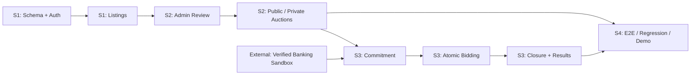
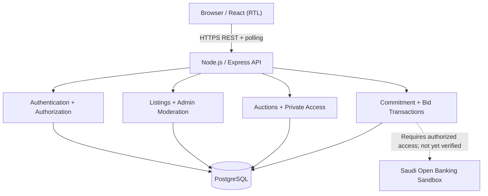
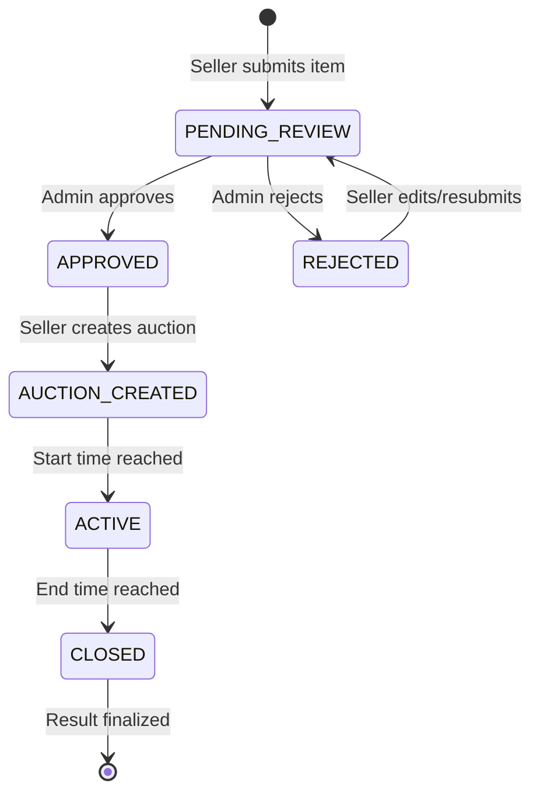
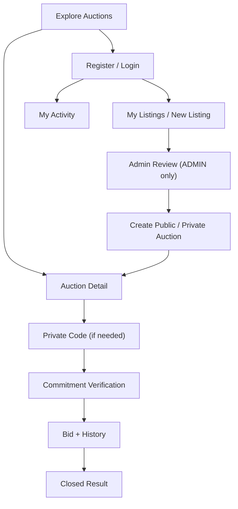

# MEZYAD
## STAGE 4 — MVP DEVELOPMENT & SPRINT EXECUTION
**Holberton School | Portfolio Project | Engineering Delivery Report**

| Project | Mezyad — Digital Auction Platform |
|---|---|
| Team | Abeer Al-Saiari · Ghadi Al-Zahrani · Aseel Al-Zahrani · Tala Al-Hudaibi |
| Source of truth | [Stage 3 Technical Report](../Stage_3/Report.MD) |
| Repository | [Mezyad on GitHub](https://github.com/ghadi0alzhrani0/Mezyad) |
| Reporting snapshot | 12 October 2026 |
| Stage | Implementation started — acceptance pending |

> **Reading guide.** This is the main submission document, organized by **Tasks 0–5**. It answers what the team planned, what the repository currently contains, how the work is structured, what constitutes proof of completion, and what remains. **Committed code is not equivalent to tested functionality; templates are not real meeting minutes.** Where no verifiable evidence exists, the report identifies the gap rather than inventing it.

### Executive summary

**Local update — 13 October 2026:** The approved Figma account interface and API
integration now have local execution evidence, with 22 backend runner entries
and 30 frontend tests passing. See [Testing Report](Testing_Report.md) for the
tested working tree and limits. Review/upload and full marketplace acceptance
remain pending; the dated source audit below is retained as the original snapshot.

Mezyad is an auction platform where one registered user can list an asset for sale and bid on other users' auctions. Administrators moderate submitted listings before auction creation. Auctions can be public or private; private participation requires a valid access grant. The bid flow requires commitment verification, minimum-price checks, transactional concurrency control, an immutable bid record, and consistent closure/winner determination. The project intentionally excludes real money movement.

The implementation repository now includes a PostgreSQL ten-table migration, Express routes, token-session authentication, a preliminary React interface, initial automated health-test source, and Stage 4 delivery artifacts. The current system is **not yet an accepted end-to-end MVP**: complete React journeys, secure image uploads, verified banking sandbox integration, live-database QA and sprint meeting evidence remain outstanding.

**Evidence index:** [Sprint plan](Sprint_Plan.md) · [Backlog](Product_Backlog.md) · [Progress](Progress_Tracker.md) · [Reviews](Sprint_Reviews.md) · [Retrospectives](Retrospectives.md) · [Testing](Testing_Report.md) · [Bugs](Bug_Tracker.md).

---

# TASK 0 — PLAN AND DEFINE SPRINTS

## 0.1 Sprint strategy

The team follows **four one-week sprints** consistent with Stage 3 §8.1. Each sprint has a business outcome, acceptance scenario, owner, dependency and review gate. Calendar start/end dates require team confirmation; “Week 1” etc. describe relative sequencing, not invented past dates.

| Sprint | Goal | Deliverable / demo scenario | Primary ownership | Gate |
|---|---|---|---|---|
| **S1: Foundation** | Make persistence and account identity possible | Apply PostgreSQL schema; register, log in and save a listing | Abeer + Tala (DB), Abeer + Ghadi (API), Aseel + Ghadi (UI) | Clean migration + tested authenticated request |
| **S2: Marketplace** | Connect moderation to auction publication | Seller submits → admin reviews → approved listing becomes public/private auction | Abeer + Ghadi (API), Aseel + Ghadi (UI), Tala (QA) | Unauthorized admin access denied; private code enforced |
| **S3: Bid integrity** | Ensure eligible bids are correct under concurrency | Verified commitment → bid → history → closure/result | Abeer + Ghadi (API), Abeer + Tala (DB), Tala + Aseel (QA) | Competing bids serialized, duplicate request rejected, correct winner |
| **S4: Integration** | Prove complete, usable workflows | Public/private browser E2E, negative tests, bug fixes, demo | Entire team; Tala + Aseel QA lead | Reproducible test report, no critical defects |

### Sprint dependency map



## 0.2 MoSCoW prioritization

| Priority | Requirements | Decision rationale |
|---|---|---|
| **Must** | Auth + User/Admin access, listings, approval, public/private auctions, code-gated private access, verified commitment, safe bidding, closure/results, React flows, PostgreSQL, tests | Core auction journey and Stage 3 contract |
| **Must / externally blocked** | Real authorized Saudi Open Banking sandbox operation | Requires actual provider access and confirmed API; cannot be simulated as a successful integration |
| **Should** | Clear UI states, input feedback, accessibility, pagination, automated regression depth | Reliability and demonstrability |
| **Could** | Additional UX refinement | After Must features |
| **Won't this stage** | Anti-sniping, Redis, WebSockets, escrow, real transfers, real KYC, blockchain, handover | Not part of the approved Stage 3 MVP |

## 0.3 Backlog, assignment and acceptance

The actionable [Product Backlog](Product_Backlog.md) maps tasks to sprint, owner, dependency, code location and acceptance evidence. For example:

| Story | Definition of accepted behavior | Evidence required |
|---|---|---|
| **US-AUTH** | A user can register, authenticate, log out; unauthorized admin calls fail | 401/403/409 API tests and session checks |
| **US-LIST** | User creates a listing; rejected listing can be edited and resubmitted; invalid images rejected | API, DB and upload negative tests |
| **US-AUCT** | Only approved items can become auctions; private code gates visibility | Admin→seller→bidder integration test |
| **US-COMMIT** | Commitment succeeds **only** after genuine authorized provider verification | Redacted official sandbox request/response and stored state |
| **US-BID** | Minimum increments, ownership, duplicate requests, expiry and concurrency enforced | Parallel-request and DB transaction logs |
| **US-RESULT** | Closure yields one stable result, including no-bid case | Repeat-close tests and DB assertions |

**Definition of Ready:** acceptance criterion stated; dependencies identified; assigned owner; design/API contract understood.  
**Definition of Done:** code merged, review evidence, actual successful test run, acceptance demonstration, no known critical defect, tracker updated. An unexecuted test is **not** “passed.”

---

# TASK 1 — EXECUTE DEVELOPMENT TASKS

## 1.1 Technical architecture



**Stack contract:** React + Vite; Express REST; PostgreSQL; polling instead of real-time sockets. No Redis, MySQL or additional seller/bidder entity. `users` has `USER` and `ADMIN` roles; the same user can be a seller on one auction and a bidder on another.

## 1.2 Database implementation

[SQL migration](../database/migrations/001_schema.sql) defines the Stage 3 ten-table model:

| Table | Purpose | Relationship / integrity focus |
|---|---|---|
| `users` | Identity, hashed credentials and role | Referenced by sessions, items, commitments and bids |
| `user_sessions` | Hashed active session tokens and expiry | Belongs to user |
| `categories` | Supported asset classifications | Referenced by items |
| `items` | Seller-owned assets and moderation state | Seller and category FKs |
| `item_images` | Listing image references | Belongs to item |
| `auctions` | Time window, visibility, price, status | References approved item |
| `private_auction_access` | Explicit private-access grants | Auction and user references |
| `bid_commitments` | Eligibility/commitment records | Auction and bidder references |
| `bids` | Accepted monetary offers | Auction, bidder and unique request identity |
| `auction_results` | Finalized winner/no-winner outcome | Auction and winning-bid integrity |

[Category seed](../database/seeds/001_categories.sql) is included. **Source review is not evidence that the migration has executed successfully**; clean-database verification is a required QA gate.

## 1.3 API implementation and business rules

The main [Express application](../backend/src/app.js) includes registration/login/logout, categories, listing creation/update, moderation, public/private auction routes, private access, bid commitment handling, bid history, bid submission, auction detail/closure and My Activity. [Auth middleware](../backend/src/auth.js) checks sessions and administrative access; [database adapter](../backend/src/db.js) uses PostgreSQL.

### Auction state / ownership



The diagram is the **intended lifecycle**; precise persisted enum names and route transition behavior must be verified against SQL/API during integration testing.

### Bid processing design

```mermaid
sequenceDiagram
  actor B as Bidder
  participant UI as React
  participant API as Express
  participant DB as PostgreSQL
  B->>UI: Submit amount + requestId
  UI->>API: POST /auctions/:id/bids
  API->>DB: BEGIN; lock auction row FOR UPDATE
  DB-->>API: Current price, time, status
  Note over API,DB: Validate auth, ownership, private access,<br/>verified commitment, price and deadline
  alt Invalid or duplicate
    API->>DB: ROLLBACK / safe duplicate response
    API-->>UI: Structured error
  else Valid
    API->>DB: INSERT accepted bid; update auction price
    API->>DB: COMMIT
    API-->>UI: Accepted bid / current state
  end
```

**Why transactional locking?** Two simultaneous bidders must not both be accepted against the same stale current price. **Why requestId?** A retry must not create duplicate accepted bids. **Why server time?** A browser countdown cannot determine legal bid acceptance. These controls are present at source level but **concurrency and timing behavior have not yet been proven by live tests**.

### Banking dependency and truthful failure behavior

The Stage 3 commitment step requires a genuine Saudi Open Banking sandbox integration. Provider identity, credentials and exact supported API operation have not been established. The current commitment route fails closed (service unavailable) rather than manufacturing a successful bank confirmation. Consequently **the full bidding journey is blocked** until an authorized provider flow is integrated and tested. Do not interpret an HTTP mock as evidence of real banking integration.

## 1.4 Frontend implementation

[React source](../frontend/src/main.jsx) contains an Arabic right-to-left starter interface, public auction discovery, periodic polling, basic account forms and auction detail. [Styles](../frontend/src/style.css) establish the initial visual treatment. These are **initial screens**, not a complete frontend. Seller listing forms, admin review dashboard, private access UI, commitment flow, bid submission, My Activity and robust error/empty states require completion.

### Intended frontend route map



This diagram describes **remaining implementation scope**, not a claim that every page exists.

## 1.5 Source control and traceability

Initial implementation and documentation were introduced in [Pull Request #1](https://github.com/Abeerr0/mezyad/pull/1) and merged into `main`. Subsequent report corrections are committed directly to `main` for the user's urgent submission. This proves source history; it does **not** prove peer review or CI success. Future development should use task branches and reviewed PRs. The Stage 3 report remains unchanged.

---

# TASK 2 — MONITOR PROGRESS AND ADJUST

## 2.1 Stand-up workflow

Each daily stand-up records **date**, **attendees**, **yesterday's verified progress**, **today's plan**, **blockers**, **assigned action** and **linked issue/PR**. The team updates [Progress Tracker](Progress_Tracker.md) using a consistent state model: `TODO → IN PROGRESS → IN REVIEW → DONE`, or `BLOCKED` with reason. No retrospective daily meetings are invented.

## 2.2 Metrics and reporting rules

| Metric | Formula | How it guides decisions |
|---|---|---|
| Sprint completion | Accepted tasks ÷ planned tasks × 100 | Detect scope spillover |
| Velocity | Accepted story points per sprint | Forecast next sprint capacity |
| Burndown | Remaining planned points each day | Detect blocked or underestimated work |
| Bug resolution rate | Verified fixed bugs ÷ verified reported bugs × 100 | Detect stabilization progress |
| Escaped defects | Bugs found after prior acceptance | Improve QA coverage |
| Blocker age | Days since blocker first recorded | Trigger escalation |

**Actual metrics:** Sprint meetings, accepted task counts, story-point baselines and QA logs have not been verified. No fabricated percentages or burndown charts are shown. The real external blocker is provider access for the banking commitment operation.

## 2.3 Decisions, escalation and corrective action

| Risk | Trigger | Action | Owner |
|---|---|---|---|
| Bank sandbox unavailable | Provider access/docs not confirmed by sprint checkpoint | Escalate to mentor/provider; document blocker; retain fail-closed behavior | Abeer + Ghadi |
| Bid race condition | Parallel requests produce inconsistent price/winner | Stop release; reproduce with concurrent test; fix transaction | Abeer + Tala |
| Incomplete React screens | Cannot demo a complete workflow | Prioritize Must screens before polish | Aseel + Ghadi |
| Unsafe image input | Unsupported/oversized upload accepted | Reject input and add negative tests | Backend + QA |
| Scope drift | Unapproved stack/feature introduced | Compare with Stage 3 and obtain team approval | Entire team |

**Evidence:** [Progress Tracker](Progress_Tracker.md) contains an explicit status snapshot and a reusable dated stand-up record.

---

# TASK 3 — CONDUCT SPRINT REVIEWS AND RETROSPECTIVES

## 3.1 Review structure

A sprint review is a **demonstration against acceptance criteria**, not a statement that a sprint was successful. Each review must capture: meeting date, participants, sprint goal, exact commit, demonstrated scenario, expected versus actual outcome, mentor/stakeholder feedback, accepted/rejected stories, follow-up owner.

| Sprint | Demonstration script | Acceptance decision |
|---|---|---|
| S1 | Register → login → submit listing → verify database row | Pending executed demo |
| S2 | Admin approves → seller creates public/private auction → private code check | Pending executed demo |
| S3 | Verify commitment → two competing bids → close → inspect result | Blocked by sandbox; remaining test evidence pending |
| S4 | End-to-end browser journey including failure states and regression | Pending executed demo |

[Review records and meeting template](Sprint_Reviews.md). No actual mentor comments or attendance are asserted without a source.

## 3.2 Retrospective structure

For each sprint, discuss **Start / Stop / Continue**, identify one or more specific improvements, and assign an owner and verification date. Examples of **proposed discussion topics**, not historical team quotes: keep database migrations small; stop merging without test evidence; continue explicit API error contracts; add concurrent-bid tests before the demo. Record actual outcomes in [Retrospectives](Retrospectives.md).

---

# TASK 4 — FINAL INTEGRATION AND QA TESTING

## 4.1 Test pyramid

| Level | Targets | Tool / evidence |
|---|---|---|
| Static and build | Node syntax, React bundle | `npm run check`, `npm run build`; logs |
| Unit | Auth helpers, validators, state calculations | Node test runner; assertions |
| API integration | HTTP status, permissions, DB writes | Test DB + HTTP client |
| Database/concurrency | Transactions, uniqueness, rollback, winner | PostgreSQL concurrent clients |
| Browser E2E | Public/private user journeys, loading/errors | Browser screenshots/video and reproducible steps |
| Security/negative | Private leakage, upload type/size, replay, expired token | Negative tests and defect records |

## 4.2 Stage 3 QA traceability matrix

The exact QA identifiers are defined in [Stage 3 §8.4](../Stage_3/Report.MD).

| Test ID | Scenario | Expected outcome | Evidence status |
|---|---|---|---|
| QA-01 | Duplicate registration email | 409; no duplicate account | Not executed |
| QA-02 | Wrong password | 401; no session | Not executed |
| QA-03 | Non-admin tries moderation | 403 | Not executed |
| QA-03A | Seller bids on own auction | Rejected | Not executed |
| QA-03B | User sells and bids elsewhere | Both roles permitted for same user | Not executed |
| QA-04 | Auction from unapproved listing | Rejected | Not executed |
| QA-05 | Invalid private code | Access denied | Not executed |
| QA-06 | Direct private GET/bid without grant | No private data or bid | Not executed |
| QA-07 | Sandbox error/timeout | Clear failure; no false approval | Not executed |
| QA-08 | Below-minimum bid | Rejected; unchanged price | Not executed |
| QA-09 | Same requestId twice | At most one accepted bid | Not executed |
| QA-10 | Two simultaneous bids | Serializable, consistent outcome | Not executed |
| QA-11 | Bid at/after endTime | Rejected by server | Not executed |
| QA-12 | Close with no bids | Closed without winner | Not executed |
| QA-13 | Repeat closure | One stable result | Not executed |
| QA-14 | Empty/loading/error UI | Clear states | Not executed |
| QA-15 | Public auction E2E | Correct final outcome | Not executed |
| QA-16 | Private auction E2E | Correct access/bidding rules | Not executed |
| QA-17 | Edit/re-submit rejected listing | Returns to pending review | Not executed |
| QA-18 | First bid equals starting price | Accepted if eligible | Not executed |
| QA-19 | Later bid below required increment | Rejected | Not executed |
| QA-20 | Winner bid belongs to another auction | Cannot record as winner | Not executed |
| QA-21 | Own listing + bids elsewhere in activity | Both appear | Not executed |
| QA-22 | Unsafe image upload | Rejected safely | Not executed; feature missing |
| QA-23 | Auction expires without page visit | Late bids rejected; next access finalizes | Not executed |

**Critical QA interpretation:** “Not executed” does not mean “failed”; it means there is no credible execution evidence. A feature missing in code, such as image upload, is a known implementation gap rather than an invented observed runtime defect.

## 4.3 Reproducible execution instructions

```bash
# Prerequisites: Node.js, npm, PostgreSQL, correctly populated .env
psql "$DATABASE_URL" -f database/migrations/001_schema.sql
psql "$DATABASE_URL" -f database/seeds/001_categories.sql

cd backend
npm install
npm run check
npm test
npm run dev

# In another terminal, from repo root:
cd frontend
npm install
npm run build
npm run dev
```

These commands are **not claimed as executed**. `npm install` is used because the repository has no committed lockfiles; do not present `npm ci` as reproducible until lockfiles exist. For complete testing, add isolated test data, reset scripts, deterministic clocks, concurrency cases, and test evidence.

## 4.4 Bug triage and release gate

Classify defects as **Critical** (authorization, data corruption, false financial approval), **High** (core flow broken), **Medium** (recoverable functional/UX problem) or **Low** (cosmetic). Record reproducible steps, expected/actual behavior, environment, owner, fix commit and retest evidence in [Bug Tracker](Bug_Tracker.md).

**Release gate:** no open Critical/High defects, Must stories accepted, successful migration and test logs, documented bank integration outcome, and successful public/private browser journeys. **Current gate: NOT MET.**

---

# TASK 5 — FINAL DELIVERABLES

| Required deliverable | Direct evidence | Honest status |
|---|---|---|
| Sprint Planning | [Sprint Plan](Sprint_Plan.md), [Backlog](Product_Backlog.md), Task 0 above | Documented; calendar dates awaiting confirmation |
| Sprint Reviews | [Sprint Reviews](Sprint_Reviews.md), Task 3 above | Procedure and scripts prepared; actual minutes pending |
| Retrospectives | [Retrospectives](Retrospectives.md), Task 3 above | Procedure prepared; actual sessions pending |
| Source repository | [GitHub main](https://github.com/Abeerr0/mezyad) | Available |
| SCM / commits | [Merged PR #1](https://github.com/Abeerr0/mezyad/pull/1) | Source history available; peer review not established |
| Progress / metrics | [Progress Tracker](Progress_Tracker.md) | Measurement framework prepared; actual daily metrics pending |
| Bugs | [Bug Tracker](Bug_Tracker.md) | Known implementation gaps documented separately from tested defects |
| QA results | [Testing Report](Testing_Report.md), Task 4 above | Test plan; full execution evidence pending |
| Backend | [app.js](../backend/src/app.js) | Initial source committed |
| Frontend | [main.jsx](../frontend/src/main.jsx) | Partial React source committed |
| Database | [Schema](../database/migrations/001_schema.sql) | Migration source committed |
| Production | Deployment URL | Not deployed / not verified |
| Task score | Mentor/evaluator result | Not yet assigned |

## Submission readiness: explicit next actions

1. **Finish:** listing image validation, seller/admin/private/commitment/bid/activity UI.
2. **Verify:** PostgreSQL migration, Express API and React build in a real environment.
3. **Resolve external dependency:** official Saudi sandbox access and actual supported operation; do not fabricate success.
4. **Test:** execute QA-01 through QA-23; attach command outputs, dates, screenshots and commit SHAs.
5. **Document reality:** enter genuine stand-ups, sprint reviews, retrospectives and mentor feedback.
6. **Release:** deploy only after acceptance gates pass; publish real URL only then.

---

### Appendix A — File navigation

| Folder/file | Why it exists |
|---|---|
| `Stage_4/Report.MD` | Single authoritative task-by-task Stage 4 submission |
| `Stage_4/Sprint_Plan.md` | Detailed sprint outcomes and dependencies |
| `Stage_4/Product_Backlog.md` | Assignable work items and acceptance criteria |
| `Stage_4/Progress_Tracker.md` | Stand-up records and measurable progress |
| `Stage_4/Sprint_Reviews.md` | Demo scripts and actual review minutes |
| `Stage_4/Retrospectives.md` | Continuous-improvement records |
| `Stage_4/Testing_Report.md` | Executed QA evidence and environment |
| `Stage_4/Bug_Tracker.md` | Defect triage and retest trail |
| `backend/` | Express service and tests |
| `frontend/` | React browser client |
| `database/` | PostgreSQL migration and seed |
| `docs/STAGE_3_REVIEW_NOTES.md` | Stage 3 design discrepancies without editing its source |

### Appendix B — Technical guardrails

PostgreSQL, ten Stage 3 tables, REST polling, one user identity for both selling/bidding, `USER`/`ADMIN` roles, no real money, no fabricated bank success, no anti-sniping in current MVP. **Stage_3/Report.MD remains unchanged.**
